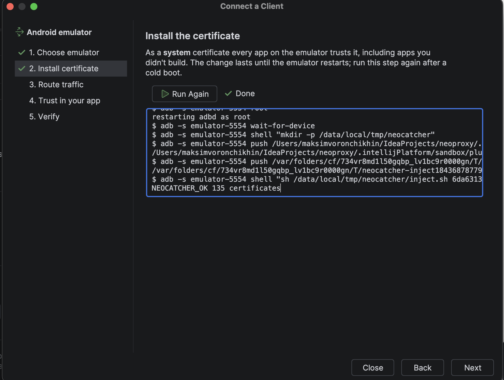
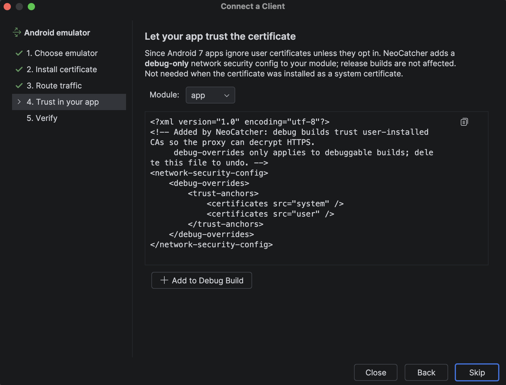

# Device setup

Every client needs two things: to **send traffic through the proxy** and to **trust the NeoCatcher certificate**.
The **Connect a Client…** wizard in the Server tab does both for you; this page is the manual reference.
Replace `9942` below if you changed the port.

## Android

### Emulator (automatic)

1. Start an emulator from Android Studio. Use a **Google APIs** image, not a **Google Play** image:
   Play images don't allow the root access needed to install the certificate.
2. **Connect a Client… → Android emulator**. NeoCatcher finds `adb` through `ANDROID_HOME`, your project's
   `local.properties` or the default SDK location, installs the certificate and sets the emulator proxy to
   `10.0.2.2:9942`.

{ loading=lazy }

The system certificate lasts until the emulator cold-boots; run the step again afterwards. When NeoCatcher stops,
it removes the proxy from the emulator again (you can turn this off in the server settings).

### Physical device or manual setup

Over USB (recommended): **Connect a Client… → Android phone** runs `adb reverse tcp:9942 tcp:9942` and points the
phone at `127.0.0.1:9942`. Manually over Wi-Fi:

1. Allow devices on your network in the server settings (gear icon) and connect the phone to the same network.
2. **Wi-Fi settings → your network → Proxy → Manual**: host = your computer's LAN IP, port = `9942`.
3. Copy the `.cer` file to the phone and install it under
   **Settings → Security → Encryption & credentials → Install a certificate → CA certificate**.

### Let your app trust the certificate

Since Android 7, apps ignore user-installed certificates unless they opt in. Add a **debug-only** network security
config:

{ loading=lazy }

```xml title="app/src/debug/res/xml/network_security_config.xml"
<network-security-config>
    <debug-overrides>
        <trust-anchors>
            <certificates src="user" />
        </trust-anchors>
    </debug-overrides>
</network-security-config>
```

```xml title="AndroidManifest.xml"
<application
    android:networkSecurityConfig="@xml/network_security_config"
    ... >
```

!!! warning
    Keep this in the debug build only. Never ship a release build that trusts user certificates.

### Release builds

A release build doesn't trust the NeoCatcher certificate, so its HTTPS calls fail while HTTPS is decrypted. You don't
have to change the proxy settings on the device: turn off **Decrypt HTTPS** in the **HTTPS certificate** section of
the **Server** tab. HTTPS then passes through to the server unseen and the release build works; plain HTTP is still
shown and changed by rules. Turn it back on for the debug build. Both take effect for new connections at once,
without a restart.

## JVM apps (Kotlin, Java, Gradle)

**Connect a Client… → Java / Kotlin app** adds the options below to a run configuration, with a NeoCatcher
truststore that also keeps the JDK's default CAs. To do it by hand, import the `.cer` into your JDK
(`keytool -importcert -cacerts -alias neocatcher -file neocatcher-ca.cer`) and start the app with:

```bash
-Dhttp.proxyHost=localhost -Dhttp.proxyPort=9942 -Dhttps.proxyHost=localhost -Dhttps.proxyPort=9942
```

OkHttp ignores these properties when you set a custom `proxy`/`proxySelector`; configure it in code instead:

```kotlin
val client = OkHttpClient.Builder()
    .proxy(Proxy(Proxy.Type.HTTP, InetSocketAddress("localhost", 9942)))
    .build()
```

## macOS

**Connect a Client… → This computer** adds the certificate to your login keychain (asks for your password).
Then set the proxy in **System Settings → Network → Details → Proxies**, or per app.

## Windows and Linux

Import the `.cer` file into the trusted root store:

=== "Windows"

    ```powershell
    certutil -addstore -user Root C:\path\to\neoproxy-cert.cer
    ```

=== "Linux (Debian/Ubuntu)"

    ```bash
    sudo cp neoproxy-cert.cer /usr/local/share/ca-certificates/neoproxy-cert.crt
    sudo update-ca-certificates
    ```

## Browsers

Firefox keeps its own certificate store: **Settings → Privacy & Security → Certificates → View Certificates →
Authorities → Import**. Chrome and Edge use the operating system store.

## iOS simulator and devices

1. Set the Wi-Fi proxy to your computer's IP and port `9942` (simulators use the Mac's proxy settings).
2. Open the `.cer` file on the device and install the profile.
3. **Settings → General → About → Certificate Trust Settings** → enable full trust for the certificate.

## Remove it when you're done

See [Security → Clean up](security.md#clean-up).
