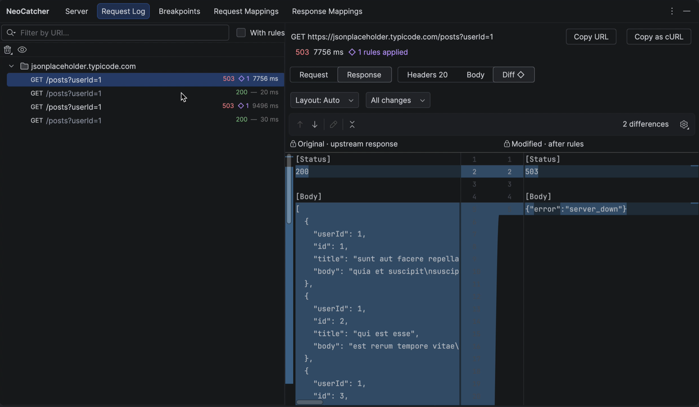
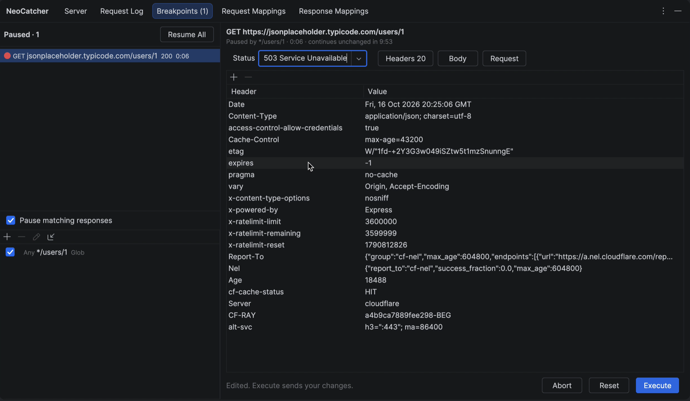
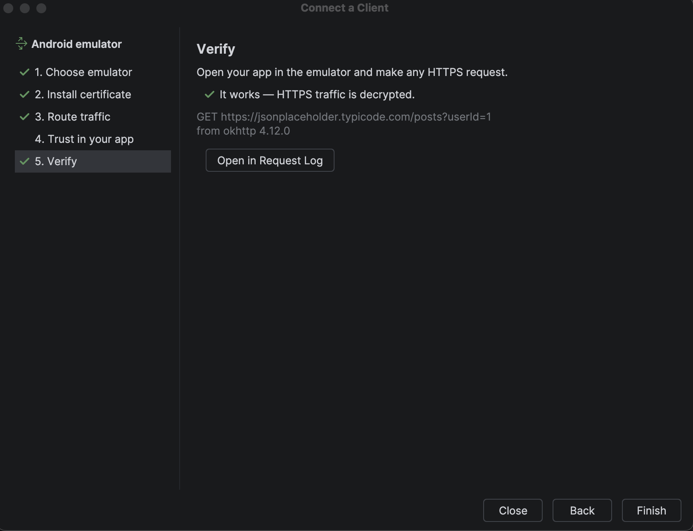

# NeoCatcher

**Catch, inspect and change your app's HTTP(S) traffic without leaving the IDE.**

NeoCatcher is a debugging proxy that lives in IntelliJ IDEA, Android Studio and other JetBrains IDEs.
Point your app or emulator at it and every request shows up in a tool window next to your code.

[Get started](getting-started.md){ .md-button .md-button--primary }
[Install from JetBrains Marketplace](#){ .md-button }

<video autoplay loop muted playsinline controls poster="assets/media/home-hero.png" width="1680" height="1050"
       aria-label="A response from an Android app is paused in NeoCatcher, changed to an error and the app shows the error card">
  <source src="assets/media/home-hero.mp4" type="video/mp4">
</video>

## Why NeoCatcher

-   **Request log in your IDE**

    ---

    Every request and response, with headers, formatted bodies and a diff of what your rules changed.
    Copy any request as cURL.

-   **Rules that mock and rewrite**

    ---

    Redirect hosts, change headers, replace bodies, force a status code. Write rules in a form,
    YAML or JSON with completion and validation.

-   **Response breakpoints**

    ---

    Pause a live response, edit its status, headers or body, then send it on — or abort the call
    to test your error handling.

-   **Built for Android developers**

    ---

    The Connect wizard installs the certificate and routes traffic for emulators, phones, JVM apps and browsers — then verifies it works.

-   **Works with your AI agent**

    ---

    Claude Code, Cursor, VS Code and other MCP clients can read captured traffic and, with your permission,
    mock responses for you. [Set it up](mcp.md).

## See what changed

### A diff for every response

Select any request and open **Diff**: the upstream response on the left, what your app actually received on the
right, with the changed status, headers and body lines highlighted. You always know what was real and what was mocked.

[Request log](request-log.md){ .md-button }

{ loading=lazy }

### Pause a live response and edit it

Set a breakpoint on a URL. When the app calls it, the response waits in NeoCatcher: change the status, headers or
body, then send it on, or abort the call to test your error handling.

[Breakpoints](breakpoints.md){ .md-button }

{ loading=lazy }

### Rules with completion and validation

Mock a body, add a header or force a status code. Write the rule in a form, or in YAML and JSON with completion,
documentation and inline errors.

[Rules](rules.md){ .md-button }

{ loading=lazy }

### Set up a client in a few clicks

The Connect wizard installs the certificate, routes the traffic and confirms the first decrypted request, for
emulators, phones, JVM apps and browsers.

[Getting started](getting-started.md){ .md-button }

{ loading=lazy }

## How it works

1. NeoCatcher starts a local HTTP(S) proxy on your machine (port `9942` by default).
2. Your app, emulator, browser or JVM process sends its traffic through that proxy.
3. NeoCatcher decrypts HTTPS with a CA certificate that only exists on your machine,
   applies your rules and breakpoints, and shows everything in the tool window.

Nothing leaves your computer: NeoCatcher does not send your traffic, or data about it, anywhere.
See [Security](security.md) and [Privacy](privacy.md).

## Free and Pro

The request log, certificate setup and up to three active rules are free forever.
Pro adds unlimited rules, rules shared through git, and breakpoints. [See pricing](pricing.md).
