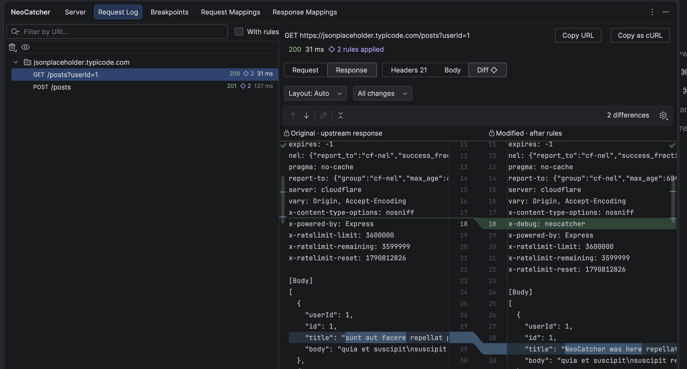

# Request log

The **Request Log** tab lists the exchanges that passed through the proxy, newest first.

## Reading an exchange

Select an entry to open its preview. Switch between **Request** and **Response**, then between:

| View | Shows |
| --- | --- |
| Headers | All headers as sent and received |
| Body | The body, formatted for JSON, XML and other common types |
| Diff | What your rules and breakpoints changed: URL, headers and body for requests; status, headers and body for responses |

Entries changed by a rule or breakpoint are labelled with its name, so you can always tell what was real and what
was mocked.

An entry shows **No response** when the server could not be reached or never answered: the proxy gives up after about
two minutes, and the app gets an error.

{ loading=lazy }

## Filtering

Type in **Filter by URI...** above the list to keep only matching requests.

## Actions

Right-click an entry:

- **Copy as cURL** — a bash/zsh command that replays the request as the server received it.
- **Add Response Breakpoint…** — pause the next responses from this endpoint. See [Breakpoints](breakpoints.md).

## Clearing the log

Use the trash button: **Delete All Log Entries** or **Delete Old Log Entries**.

The log lives in the IDE's memory for the current session. It is not uploaded anywhere. It keeps the latest 10,000
calls, with at most a tenth of the IDE's memory for bodies; the oldest calls make room for new ones.
