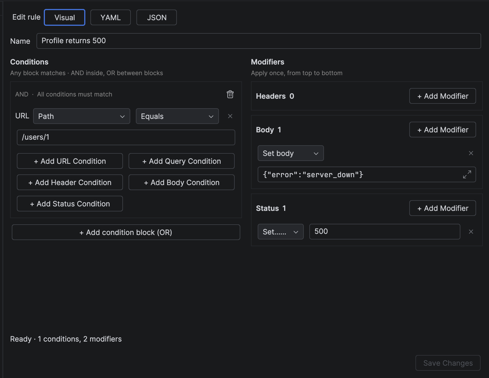
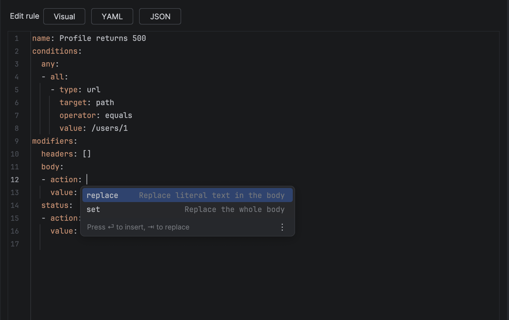

# Rules

Rules change traffic automatically: redirect a host, add a header, mock a body, force an error status.

- **Request Mappings** change requests before they reach the server.
- **Response Mappings** change responses before they reach your app.

Each rule has a checkbox in the list (or press ++space++) to turn it on and off without deleting it.
Disabled rules stay in place, greyed out, and keep their order.

!!! info "Free and Pro"
    The free edition runs up to three active rules at a time. [Pro](pricing.md) removes the limit.

## Editing a rule

The editor has three modes that stay in sync:

- **Visual** — a form with conditions on one side and modifiers on the other.
- **YAML** and **JSON** — full source with completion, inline validation and quick documentation
  (uses the IDE's bundled JSON/YAML support).

{ loading=lazy }

{ loading=lazy }

Invalid drafts are kept, and errors point to the exact field (`conditions.any[0].all[1] ...`) or YAML line and column.
Click **Save Changes** to apply.

## How matching works

```yaml
conditions:
  any:          # OR: the rule matches when any block matches
    - all:      # AND: every condition in the block must match
        - ...
```

| Condition `type` | Checks |
| --- | --- |
| `url` | `target`: `host`, `path` or `wholeUrl` |
| `query` | A query parameter |
| `header` | A request or response header |
| `body` | A request or response body |
| `status` | The response status code (response rules) |
| `all` | Every response |

Operators: `equals` and `contains` compare literal text, `glob` matches the whole value (`*` any text, `?` one
character), `regex` searches the value.

Modifiers run top to bottom, by category: **URL → Headers → Body → Query** for requests, **Headers → Body → Status**
for responses.

## Examples

### Mock a server error

```yaml
name: Login returns 500
conditions:
  any:
    - all:
        - type: url
          target: path
          operator: equals
          value: /api/login
modifiers:
  status:
    - action: set
      value: "500"
  body:
    - action: set
      value: '{"error": "server_down"}'
```

### Send the app to staging

```yaml
name: Use staging API
conditions:
  any:
    - all:
        - type: url
          target: host
          operator: equals
          value: api.example.com
modifiers:
  url:
    - action: setHost
      value: staging.example.com
      updateHostHeader: true
```

### Add a debug header to every response

```yaml
name: Debug header
conditions:
  any:
    - all:
        - type: all
modifiers:
  headers:
    - action: add
      name: X-Debug
      value: neocatcher
```

## Modifier reference

| Rules | Category | Actions |
| --- | --- | --- |
| Request | `url` | `setHost`, `setPath`, `setUrl`, `replaceHost`, `replacePath` |
| Both | `headers` | `add` (keep existing), `update` (replace all with this name), `remove` |
| Both | `body` | `set` (whole body), `replace` (every occurrence of literal text) |
| Request | `query` | Change query parameters |
| Response | `status` | `set` (a code from 100 to 599, quoted) |

The editor's completion lists every field with its documentation, so you rarely need this table.
